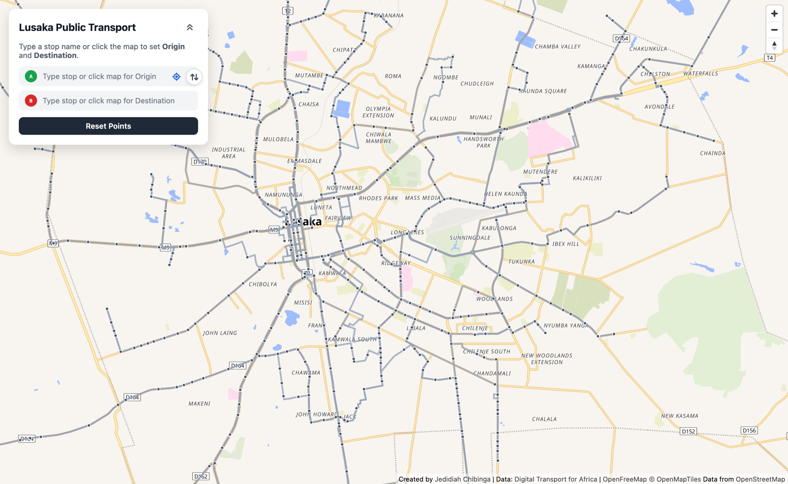

# Lusaka Public Transport Route Finder

An interactive, client-side web map and transit route planner for Lusaka, Zambia. Built with **MapLibre GL JS**, **OpenFreeMap**, and **Turf.js**, it allows commuters and urban planners to explore informal and formal bus corridors, inspect stops, and compute direct or 1-transfer itineraries directly in the browser—with zero backend servers or API tokens required.

🔗 **Live Demo:** [https://jayd0421.github.io/lusaka-transit/](https://jayd0421.github.io/lusaka-transit/)

[](https://jayd0421.github.io/lusaka-transit/)

---

## Features

- **0-Transfer & 1-Transfer Transit Routing:** Computes direct bus routes and multi-leg journeys across 136 directional corridors and 793 stops using client-side spatial indexing (`Turf.js`).
- **Direction-Aware Stop Snapping:** Filters stops by proximity and left-hand traffic travel bearing so routes match stops on the correct side of dual carriageways.
- **Multiple Input Methods:**
  - Click anywhere on the map to drop **Origin (A)** and **Destination (B)** pins.
  - Type to search and autocomplete from all mapped Lusaka bus stops.
  - Use **Live GPS Geolocation** () to route from your current position.

  - One-click **Swap (`⇅`)** button to reverse origin and destination for return trips.
- **Interactive Map Inspection:**
  - Click any bus stop to view all routes serving that stop and set it as your destination with a **"Go here"** button.
  - Click any route line to inspect vehicle type (e.g., Minibus, Rosa-Coaster), passenger capacity, fare (ZMW), and route length.
  - Displays dashed walking connectors (`Origin → Boarding Stop`, `Transfer Walk`, and `Alighting Stop → Destination`) alongside color-coded boarding, transfer, and alighting stop markers.
- **Responsive Mobile Layout:** Automatically adapts into a collapsible bottom sheet on mobile screens.

---

## Tech Stack

- **Map Rendering:** [MapLibre GL JS](https://maplibre.org)
- **Vector Basemap:** [OpenFreeMap](https://openfreemap.org) (`Liberty` style)
- **Client-Side Spatial Analysis:** [Turf.js](https://turfjs.org)
- **Frontend:** Vanilla HTML5, CSS3, and JavaScript (ES6+) — zero build step

---

## Project Structure

```text
lusaka-transit/
├── index.html                        # App layout, autocomplete datalist, and UI controls
├── style.css                         # Desktop sidebar, mobile bottom-sheet, and popup styles
├── app.js                            # MapLibre setup, spatial indexing, routing engine, and popups
├── README.md                         # Project documentation
├── assets/                           # Preview image and icons
├── analysis/
│   ├── animations.ipynb              # GTFS + MovingPandas + Kepler.gl trajectory animation
│   ├── quantitative.ipynb            # r5py travel-time matrix and isochrone maps
│   ├── map1_isochrone_polygons.png   # Filled travel-time isochrone bands
│   └── map2_street_travel_times.png  # Street-level transit reachability map
└── data/
    ├── gtfs.zip                      # Lusaka GTFS feed
    ├── lusaka.osm.pbf                # OpenStreetMap extract for r5py routing
    ├── processed_trips.geojson       # Cleaned directional bus route itineraries
    └── processed_stops.geojson       # Digitized bus stop locations
```

---

## Running Locally

Because modern browsers restrict `fetch()` requests to local GeoJSON files over the `file://` protocol, serve the folder using any local HTTP server:

```bash
# Using Python 3
python -m http.server 8000
```

Then open [http://localhost:8000](http://localhost:8000) in your browser.

---

## Data Source & Credits

- **Transit Dataset:** [Digital Transport for Africa — Lusaka Public Transport Data](https://gitlab.com/digitaltransport/data/africa/lusaka)
- **Basemap Data:** © [OpenStreetMap](https://openstreetmap.org) contributors, rendered via [OpenFreeMap](https://openfreemap.org)
- **Author:** Created by [Jedidiah Chibinga](https://jedidiahchibinga.wixsite.com/jedidiah-chibinga) — Earth Observation & Geospatial Data Scientist
